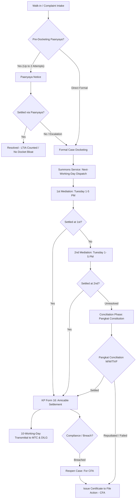

# Katarungang Pambarangay (KP) Management System
## System Enhancement Specifications & Implementation Checklist

> **Note:** This document consolidates all operational feedback, statutory procedures, and functional requirements gathered during stakeholder consultations with the Barangay Secretary and Lupon representatives (**Barangay Tumana, Marikina City**).

---

## 1. Executive Summary & Core Workflows

The system centralizes and automates the **Katarungang Pambarangay (KP)** dispute resolution process as mandated by the **Local Government Code of 1991 (RA 7160)** and **DILG guidelines**.

### Key System Goals
1. **Pre-Docketing Diversion**: Establishing an informal **"Paanyaya"** phase to settle disputes before official docketing, supporting high settlement rates for the **Lupon Tagapamayapa Incentives Awards (LTIA)**.
2. **Statutory Timeline Automation**: Strict adherence to the next-working-day summons service and the 10-working-day post-settlement transmittal to the Municipal Trial Court (MTC) and DILG.
3. **Barangay Schedule Constraints**: Restricting Punong Barangay mediation strictly to **Tuesdays (1:00 PM – 5:00 PM)** with dynamic hearing queue management, while reserving other weekdays for Pangkat Conciliation.
4. **Post-Settlement Enforcement & Reopening**: Allowing settled cases to be reopened with a status of **"For CFA"** if terms of amicable settlement are breached.

---

## 2. Actionable Implementation Checklist

### Phase 1: Pre-Docketing & Complaint Intake
- [x] `[High]` **Implement "Paanyaya" (Invitation) Workflow**
  - Add pre-docketing status where no official case docket number is assigned.
  - Implement a counter for Paanyaya attempts (maximum 2 attempts allowed).
  - Add close action: `"Settled via Paanyaya"` (increments LTIA amicable resolution metrics without generating formal case bloat).
  - Add 1-click escalation button: `"Escalate to Formal Docketing"`, transferring all party and narrative details into a formal docketed case.
- [x] `[Medium]` **Punong Barangay E-Signature Integration for Paanyaya**
  - Enable digital signature embedding for the Barangay Captain on Paanyaya notices.
  - Store and link a digital copy of the Captain's authorization letter authorizing the Secretary/Lupon to issue signed Paanyaya notices during off-site duties.
- [ ] `[High]` **Bilingual Case Categorization (English / Tagalog)**
  - Update complaint nature dropdowns to display side-by-side English and Tagalog definitions (*e.g., Malicious Mischief / Sadya at Masamang Paninira, Slander / Paninirang-Puri*).
  - Add Tagalog subtitles/tooltips to legal screening questions.
- [x] `[Medium]` **Narrative AI Clarification & Evidence Intake**
  - Connect text enhancement pipeline to clean up and structure informal or fragmented narratives provided by walk-in complainants.
  - Retain raw input alongside the enhanced narrative for audit and validation.
  - Enable multiple photo and document attachments for incident evidence.

---

### Phase 2: Service of Process & Summons Engine
- [ ] `[High]` **Enforce Next-Working-Day Service Rule**
  - Auto-set target service dispatch date to the immediately following working day (excluding weekends and statutory holidays).
- [ ] `[High]` **Single Summon (KP Form 9) & Failure to Appear Logic**
  - Restrict issuance of KP Form 9 strictly to the 1st hearing.
  - Replace reissuing KP Form 9 on the 2nd hearing with an official Notice of Failure to Appear.
- [ ] `[Medium]` **Process Server Return Tracker**
  - Provide process server logging for up to 6 attempted service entries with status options: *Served*, *Unserved (Address Not Found)*, *Unserved (Refused)*, *Unserved (Party Moved)*.
- [ ] `[Medium]` **Summons Server Excel Activity Export**
  - Exportable sheet containing: Docket Date, Target Service Date, Actual Service Date, Process Server Name, Status, and Recipient Relationship.

---

### Phase 3: Mediation Engine (Punong Barangay Phase)
- [x] `[High]` **Working-Day Mediation Scheduling (8:00 AM – 5:00 PM)**
  - Enable Punong Barangay mediation scheduling across all regular working days (Monday through Friday, 8:00 AM to 5:00 PM) within the statutory 15-working-day window.
  - Hard cap daily sessions at 8 mediation hearings per day with Lupon Court Room collision detection.
  - Parameterize working days and daily capacity in Barangay Settings so Lupon administrators can tailor hearing slots.
- [x] `[High]` **Maximum 2 Mediation Sessions Limit**
  - Hard cap mediation at exactly 2 sessions (1st and 2nd Mediation). Remove any 3rd mediation stage; case must automatically transition to Pangkat formation if unresolved after the 2nd session.
- [x] `[High]` **Dynamic / Flexible Queue Management**
  - Allow reordering and calling waiting cases ahead of schedule if both parties are marked present, preventing idle courtroom time when scheduled morning parties are delayed.
  - Provide an *Arrived / In Attendance* toggle per party.
- [ ] `[Medium]` **Emergency Session Postponement**
  - In case of unexpected Captain seminars/official travel, add a 1-click `"Reset / Postpone Session"` button that moves hearings to the next available working day and prompts staff to log telephone notice confirmations.

---

### Phase 4: Conciliation Engine (Pangkat Tagapagkasundo Phase)
- [ ] `[High]` **Conciliation Day Availability**
  - Enable Conciliation scheduling on Mondays, Wednesdays, Thursdays, and Fridays.
  - Block Tuesdays for Conciliation hearings to avoid courtroom and staff conflict with Captain's mediations.
- [ ] `[Medium]` **Lupon Daily Duty Roster**
  - Create a management interface to assign groups of Lupon members to specific weekdays (*e.g., 3 Lupon members on duty per day*).
- [x] `[Medium]` **Pangkat Selection Mechanism**
  - Allow selecting 3 Pangkat members (Chairperson, Secretary, Member) filtered by:
    1. Assigned duty roster on the chosen conciliation day.
    2. Mutual agreement of complainant and respondent.
    3. Chairman appointment / draw lots.
- [x] `[High]` **Tri-Panel Side-by-Side Pangkat Preview (KP Forms 10, 11, and 12)**
  - Multi-form preview modal (`#pangkatNoticesModal`) displaying KP Form 10 (Notice for Constitution), KP Form 11 (Notice to Chosen Members), and KP Form 12 (Notice of Hearing) side-by-side.
  - Dedicated individual Print and Download PDF controls for each panel, alongside bulk `Print All 3 Forms` action with staggered iframe printing.
- [x] `[High]` **KP Form 12 Officer's Return Tracking Linkage**
  - Connects KP Form 12 notices directly to the Officer's Return proof of service tracking system for both Complainant and Respondent (`gps/proof-service.php?complaint_id=[id]&stage=Conciliation&form=KP12`).
- [x] `[High]` **Voluntary Arbitration End-to-End Workflow & 4-Step Progressive Timeline (RA 7160 Sec. 413)**
  - In Mediation/Conciliation session minutes outcome determination, selecting "Submit to Voluntary Arbitration (KP Form 14)" provides a direct `Issue Arbitration →` action button (removing preliminary KP 14 & 15 preview buttons from minutes banner).
  - Automatically records stage outcome as `Arbitration`, finalizes hearing minutes, unlocks Outcomes tab, and transitions directly to `#arbitrationProgressiveWorkspace`.
  - **4-Step Progressive Timeline Workspace** on the Outcomes tab:
    - **Step 1: Agreement to Arbitrate (KP Form 14)** with Day 0 date display, Preview, Print, and PDF download.
    - **Step 2: 5-Day Statutory Repudiation Window** with live visual badge indicator (`Day [X] of 5 (Active)` vs `Window Closed`) and full preview/print accessibility for KP Form 17 (*Katibayan ng Pagsalungat*).
    - **Step 3: Segregated Arbitration Hearing Scheduler**: Enables scheduling arbitration sessions (same day or succeeding days) strictly classified as `Arbitration Hearing` (e.g., `1st Arbitration Hearing`), segregated from mediation/conciliation.
    - **Step 4: Statutory Day 6–15 Arbitration Award Modal & Issuance (KP Form 15)**: Client-side and server-side date validation enforcing that KP Form 15 cannot be issued earlier than Day 6 (post 5-day repudiation window) and cannot exceed Day 15 (`Date Signed + 15 days`). Once rendered, unlocks KP Form 15 preview and printing.
  - `KpFormService.php`: Auto-populates `arbitration_hearing_dates` into KP Form 15 and allows KP Form 17 during active arbitration stage.
- [x] `[High]` **Dynamic Outcome-Driven KP Forms Unlocking (KP Forms 14, 15, 16, 17, 20, 20-A, 20-B)**
  - Dynamically surfaces corresponding official KP forms in the Official KP Forms table based on recorded outcomes (Amicably Settled, Voluntary Arbitration, Repudiated Settlement, CFA).
  - Clicking `Open Amicable Settlement →` automatically records/finalizes minutes as `Settled`, unlocks the Outcomes tab, and transitions directly to `#amicableSettlementWorkspace`.

---

### Phase 5: Amicable Settlement, Transmittals & Case Reopening
- [x] `[High]` **KP Form 16 (Amicable Settlement) Generation & Automated Outcome Persistence**
  - Automatically populate the agreement body from hearing minutes.
  - Ensure the settlement execution date is prominently printed at the bottom of the form.
  - In session minutes, clicking `Open Amicable Settlement →` executes `issueSettledOutcome()`, auto-saving `case_stages` and `hearing_minutes` as `Settled` and opening the Amicable Settlement workspace.
  - `HearingMinutes.php` synchronizes `cases.case_status = 'Settled'` and `complaints.status = 'Settled'` whenever minutes are finalized with `Settled`.
- [x] `[High]` **Automated 10-Working-Day Transmittal Calculator**
  - Count exactly 10 working days (excluding Saturdays, Sundays, and public holidays) from the date of amicable settlement execution.
  - Generate automated reminder alerts on the Secretary's dashboard when transmittal deadlines approach.
- [x] `[High]` **Official DILG/MTC Transmittal Letter Template**
  - Integrate the official DILG transmittal template addressed to the local Municipal Trial Court (MTC) and the DILG Field Office.
  - Set the signature block specifically for the Barangay Secretary.
- [x] `[High]` **Case Reopening Workflow for Breach (Certificate to File Action)**
  - Remove permanent lock on settled cases.
  - Add action: `"Reopen Case: Non-Compliance / Breach of Settlement"`.
  - Fixed `backend/api/cases/reopen.php` session initialization and role authorization checks (`$_SESSION['role_id']`).
  - Flag record status as: `"Violated"`, log non-compliance in case history, and redirect to `cfa.php` with pre-filled case and breach narrative.

---

### Phase 6: Reporting, Dashboard & Form Polish
- [ ] `[High]` **Top-Navigation Reports Hub**
  - Relocate Reports to the primary top navigation bar for one-click access.
  - Add filtered views for: Monthly Summaries, Quarterly Settled Cases, and Annual Performance Reports.
- [x] `[High]` **Master Case Register Excel Export**
  - One-click export including:
    - Case Docket Number (e.g., 2026-001)
    - Complainant Name(s)
    - Respondent Name(s)
    - Title / Nature of Dispute (Civil vs. Criminal)
    - Filing Date & First Hearing Date
    - Case Status (Mediated, Conciliated, Dismissed, Repudiated, For CFA)
- [x] `[High]` **Master Document Center & DOCX Template Engine**
  - Native `.docx` master template parsing (`DocxTemplateService.php`) preserving character formatting, tables, and alignment.
  - Standardized Arial typography (`font-family: Arial, Helvetica, sans-serif;`) across all official KP documents.
  - Zero browser header/footer print rules (`@page { margin: 10mm; }`) to suppress automatic URLs and timestamps.
  - Responsive print media scaling for standard Legal (`8.5in x 14in`) and A4 bond paper.
  - Customizable Barangay and City seals, with obsolete Office Name Banner removed.
  - Canonical modal preview titles displaying strictly the KP Form number (e.g. `KP FORM 7`, `KP FORM 20`).
- [x] `[High]` **2nd Mediation Scheduling Modal & Hearing Minutes Save Fix**
  - Fixed database column missing error (`actual_duration_minutes`, `actual_start_time`, `queue_status`) for MySQL 8.0/8.4+.
  - Removed obsolete inline Next Steps section in mediation workspace; minutes saving now succeeds cleanly without validation blocking.
  - Selecting "No Settlement → Set Another Meeting" (`Continue Mediation`) automatically launches the high-fidelity 2nd Mediation Scheduling modal with the interactive 15-working-day calendar.
  - Universal operating hours: Mediation sessions can be booked on all working days (Monday to Friday, 8:00 AM – 5:00 PM), fully lifting old Tuesday-only locks.
  - Displays statutory notice exemption under RA 7160 Sec. 410 (bypassing KP Form 9 summons since parties sign minutes in person).
- [x] `[Medium]` **Blank KP Forms Repository & Ruled Minutes Template**
  - Add a dedicated repository tab containing clean, printable blank PDF templates of standard DILG KP Forms (Forms 7, 8, 9, 10, 11, 16, etc.) for manual standby use.
- [ ] `[Medium]` **KP Form 7 Layout Correction**
  - Adjust print CSS / document template to move the Punong Barangay signature block lower, ensuring it is not horizontally parallel with the Complainant signature line.
- [x] `[Medium]` **Dual-Mode Hearing Minutes & Separated Session Cards**
  - Support both direct typing of hearing minutes into rich-text fields and uploading scanned/photographed physical minute sheets.

---

## 3. Statutory Compliance & Reference Matrix

| Feature / Requirement | Statutory / Policy Basis | Implementation Rule in System |
| :--- | :--- | :--- |
| **Summons Service Window** | Sec. 410(b), RA 7160 | Dispatched on the next working day after docketing. |
| **DILG / MTC Transmittal** | Sec. 411, RA 7160 | Transmitted within 10 working days from settlement date. Weekends and holidays excluded. |
| **Mediation Hearing Limit** | Sec. 410(b), RA 7160 | Punong Barangay has 15 days; strictly capped at 2 hearings before Pangkat constitution. |
| **Notice on Failure to Appear**| Katarungang Pambarangay Rules | Issued after respondent is served summons once and fails to attend 1st hearing. |
| **CFA for Breached Settlement**| Sec. 417, RA 7160 | Reopen settled case within execution window if uncomplied; status flagged as "For CFA". |
| **LTIA Metric Optimization** | DILG Memo Circular on LTIA | Pre-docketing Paanyaya resolves neighborhood disputes without formal case docket assignment. |

---

## 4. User Acceptance Testing (UAT) Schedule

- **Proposed Date & Time**: Upcoming Monday at 9:00 AM *(immediately following the Barangay Flag Ceremony)*.
- **Target Participants**: Barangay Secretary, Lupon Tagapamayapa duty members, and System Developers.
- **Testing Scope**: Walk-in complaint filing, Paanyaya generation, Tuesday dynamic mediation queue, Pangkat selection from daily duty roster, KP Form 16 transmittal deadline calculation, and Master Case Register Excel export.
